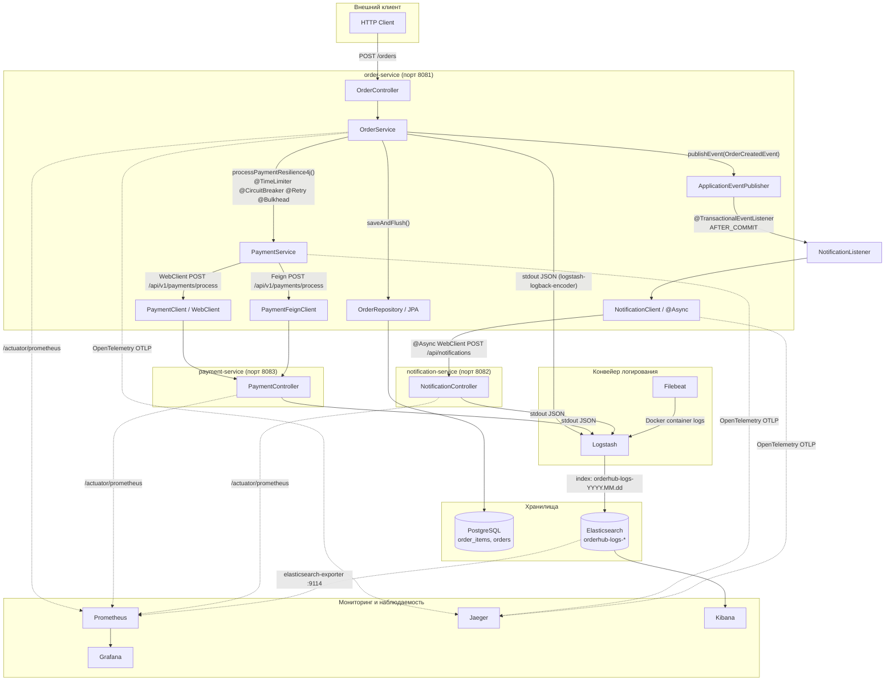

# OrderHub

> **Проект, эволюционирующий из монолита к production-ready микросервису**

[](https://openjdk.org/projects/jdk/21/)
[](https://spring.io/projects/spring-boot)
[](https://spring.io/projects/spring-cloud)
[](https://resilience4j.readme.io/)
[](https://www.jooq.org/)
[](https://www.liquibase.org/)
[](https://www.docker.com/)

---

## 1. Общее описание и архитектура системы

### Назначение проекта

**OrderHub** — это учебно-производственная микросервисная система оформления заказов, демонстрирующая современные паттерны отказоустойчивости, наблюдаемости и контейнеризации на стеке Spring Boot. Проект состоит из трёх независимых сервисов:

| Сервис | Порт | Назначение |
|---|---|---|
| **`order-service`** | `8081` | Центральный оркестратор: приём заказов, сохранение в БД, вызов платёжного шлюза, инициация уведомлений через события. Единственный сервис, владеющий схемой данных. |
| **`payment-service`** | `8083` | Платёжный шлюз: принимает запросы на оплату, эмулирует success/failure/timeout для демонстрации Circuit Breaker и Retry. |
| **`notification-service`** | `8082` | Сервис уведомлений: получает события о созданных заказах, эмулирует асинхронную отправку (email/sms/push). |

**Зоны ответственности:**

- **`order-service`** (ядро системы):
  - REST API: `POST /orders` (создание), `GET /orders/{id}` (получение с позициями), `GET /orders/admin/failure-mode` (включение хаос-режима).
  - Валидация входных DTO через Bean Validation (`@Valid`, `@NotEmpty`, `@Min`, `@DecimalMin`) — см. [`CreateOrderRequestDto`](order-service/src/main/java/oleborn/orderservice/order/domain/dto/CreateOrderRequestDto.java).
  - Персистентность: JPA/Hibernate поверх PostgreSQL, управление схемой через **Liquibase**-миграции.
  - Генерация jOOQ-классов на основе Liquibase-чейнджлогов (альтернативный доступ к данным), пакет `oleborn.assistant_core.jooq`.
  - Бизнес-метрики через кастомную аннотацию `@BusinessMetric` и AOP-аспект [`BusinessMetricAspect`](order-service/src/main/java/oleborn/orderservice/order/metrics/aspect/BusinessMetricAspect.java).
  - Публикация доменного события [`OrderCreatedEvent`](order-service/src/main/java/oleborn/orderservice/order/domain/dto/OrderCreatedEvent.java) после успешной оплаты — слушатель [`NotificationListener`](order-service/src/main/java/oleborn/orderservice/order/listener/NotificationListener.java) реагирует на него в фазе `AFTER_COMMIT`.
  - MDC-проброс контекста (traceId, order_id, total_amount) через [`MdcFilter`](order-service/src/main/java/oleborn/orderservice/order/config/MdcFilter.java) и [`TracingTaskDecorator`](order-service/src/main/java/oleborn/orderservice/order/config/TracingTaskDecorator.java).

- **`payment-service`** (внешняя зависимость):
  - REST API: `POST /api/v1/payments/process`, `GET /api/v1/payments/admin/failure-mode`.
  - В хаос-режиме (`failureMode=true`) с вероятностью 60% засыпает на 5 секунд (триггерит TimeLimiter в order-service), в остальных 40% случаев сразу возвращает успешный ответ.
  - Не имеет собственной БД — полностью stateless.

- **`notification-service`** (внешняя зависимость):
  - REST API: `POST /api/notifications`.
  - С вероятностью 30% бросает `RuntimeException`, с 30% — задержка 200 мс (не влияет на основной поток, т.к. вызывается асинхронно через `@Async`).
  - Не имеет собственной БД.

### Схема взаимодействия (Mermaid)



> **Примечание:** Filebeat и прямое TCP-подключение Logstash — альтернативные маршруты доставки логов в Elasticsearch. Filebeat читает stdout Docker-контейнеров и отправляет в Logstash на порт `5000`. Приложения также настроены на профиль `elk` и пишут структурированный JSON через `logstash-logback-encoder`, который Logstash принимает напрямую.

---

## 2. Технологический стек и инфраструктура

### Версии Java, Spring Boot, Maven и ключевых библиотек

| Компонент | Версия | Источник |
|---|---|---|
| **Java** | 21 | [`pom.xml`](pom.xml#L24) |
| **Spring Boot** | 3.5.10 | [`pom.xml`](pom.xml#L19) — родительский `spring-boot-starter-parent` |
| **Spring Cloud** | 2025.0.1 | [`order-service/pom.xml`](order-service/pom.xml#L17) |
| **Maven** | 3.9.6 (в Docker) | [`order-service/Dockerfile`](order-service/Dockerfile#L21) |
| **Liquibase** | 4.31.1 (в jOOQ-плагине) | [`order-service/pom.xml`](order-service/pom.xml#L202-L203) |
| **jOOQ** | 3.19.0 | [`pom.xml`](pom.xml#L26) — централизованное свойство |
| **PostgreSQL JDBC** | 42.7.13 (в jOOQ-плагине) | [`order-service/pom.xml`](order-service/pom.xml#L206-L208) |
| **logstash-logback-encoder** | 7.4 | Все три сервиса |
| **Micrometer Tracing (OTel)** | через Spring Boot 3.5.10 | `micrometer-tracing-bridge-otel`, `opentelemetry-exporter-otlp` |
| **Resilience4j** | через Spring Cloud 2025.0.1 | `spring-cloud-starter-circuitbreaker-reactor-resilience4j`, `resilience4j-spring-boot3`, `resilience4j-micrometer` |
| **OpenFeign** | через Spring Cloud 2025.0.1 | `spring-cloud-starter-openfeign` |
| **Lombok** | через Spring Boot BOM | Все модули |

### Инфраструктурные контейнеры (`docker-compose.yaml`)

Проект разворачивается одной командой `docker-compose -f docker-compose.yaml -p orderhub up -d --build`. Полный стек включает **12 контейнеров** в изолированной bridge-сети `orderhub-network`:

| Контейнер | Образ | Порты | Назначение |
|---|---|---|---|
| **postgres** | `postgres:15-alpine` | `5435:5432` | Production-конфигурация PostgreSQL: `max_connections=100`, `shared_buffers=256MB`. Healthcheck через `pg_isready`. Данные персистентны в volume `orderhub_postgres_data`. |
| **order-service** | Multi-stage build | `8081:8081` | Spring Boot приложение. Зависит от `postgres` (service_healthy). Healthcheck: `curl /actuator/health`. |
| **payment-service** | Multi-stage build | `8083:8083` | Сервис оплаты. Healthcheck: `curl /actuator/health`. |
| **notification-service** | Multi-stage build | `8082:8082` | Сервис уведомлений. Healthcheck: `curl /actuator/health`. |
| **prometheus** | `prom/prometheus:v2.47.0` | `9095:9090` | Сбор метрик со всех сервисов (конфиг [`prometheus.yml`](order-service/src/main/resources/prometheus.yml)). Хранит метрики 15 дней в volume `orderhub_prometheus_data`. |
| **grafana** | `grafana/grafana:10.2.2` | `3000:3000` | Визуализация метрик. Учётные данные из `.env`. Данные в volume `orderhub_grafana_data`. |
| **jaeger** | `jaegertracing/all-in-one:1.52` | `16686:16686`, `4318:4318` | Трассировка (OpenTelemetry OTLP). Хранение спанов в памяти. |
| **elasticsearch** | `elasticsearch:8.11.0` | `9200:9200`, `9300:9300` | Поисковый движок для логов. Single-node, отключена безопасность (`xpack.security.enabled=false`). |
| **elasticsearch-exporter** | `prometheuscommunity/elasticsearch-exporter:latest` | `9114:9114` | Экспорт метрик ES в Prometheus. |
| **logstash** | `logstash:8.11.0` | `5000:5000`, `9600:9600` | Принимает логи через Beats на порту 5000, трансформирует и отправляет в Elasticsearch. |
| **kibana** | `kibana:8.11.0` | `5601:5601` | UI для просмотра логов Elasticsearch. Локализация: `ru`. |
| **filebeat** | `elastic/filebeat:8.11.0` | — | Читает Docker-логи контейнеров через `/var/lib/docker/containers`, фильтрует только `order_service`, `notification_service`, `payment-service`, парсит JSON и отправляет в Logstash. |

**Persistent volumes:** `orderhub_postgres_data`, `orderhub_prometheus_data`, `orderhub_grafana_data`, `orderhub_elasticsearch_data`.

### Dockerfile (multi-stage build)

Все три сервиса используют идентичный паттерн **multi-stage build** — два этапа:

1. **Builder** (`maven:3.9.6-eclipse-temurin-21`):
   - Копирует родительский `pom.xml` и `pom.xml` модуля.
   - Выполняет `mvn dependency:go-offline -B` с кэшированием Maven-зависимостей (`--mount=type=cache,target=/root/.m2`).
   - Копирует исходники и собирает jar командой `mvn clean package -DskipTests -B`.
2. **Final** (`eclipse-temurin:21-jre-alpine`):
   - Минимальный образ (~5 МБ Alpine + JRE).
   - Устанавливает `curl` для healthcheck-ов.
   - Создаёт непривилегированного пользователя `spring:spring`.
   - Копирует jar из этапа builder.
   - `EXPOSE` порта, `USER spring`, встроенный `HEALTHCHECK`, `ENTRYPOINT ["java", "-jar", "app.jar"]`.

Пример: [`order-service/Dockerfile`](order-service/Dockerfile), [`payment-service/Dockerfile`](payment-service/Dockerfile), [`notification-service/Dockerfile`](notification-service/Dockerfile).

### Конвейер логирования (Logstash + Filebeat)

#### `filebeat.yml`

Файл [`filebeat.yml`](filebeat.yml) настраивает сбор логов из stdout Docker-контейнеров:

```yaml
filebeat.inputs:
  - type: container
    paths: /var/lib/docker/containers/*/*.log

processors:
  - add_docker_metadata       # обогащает метаданными контейнера
  - drop_event:               # фильтрует — только три сервиса OrderHub
      not.or:
        - equals: { container.name: "order_service" }
        - equals: { container.name: "notification_service" }
        - equals: { container.name: "payment-service" }
  - decode_json_fields:       # парсит JSON-сообщения (логи в JSON-формате)
      fields: ["message"]
  - drop_fields: ["stream", "attrs"]  # удаляет шум

output.logstash:
  hosts: ["logstash:5000"]
```

#### Logstash pipeline

Конфигурация [`logstash/pipeline/logstash.conf`](logstash/pipeline/logstash.conf):

```ruby
input  { beats { port => 5000 } }

filter {
  mutate {
    rename => {                          # маппинг полей в ECS-совместимый формат
      "traceId"    => "[trace][id]"
      "spanId"     => "[span][id]"
      "service"    => "[service][name]"
      "level"      => "[log][level]"
      "logger_name"=> "[log][logger]"
      "thread_name"=> "[process][thread][name]"
    }
    remove_field => [...]                # очистка служебных полей
    add_field    => { "event.dataset" => "orderhub.logs", "event.module" => "orderhub" }
  }
}

output {
  elasticsearch {
    hosts => ["http://elasticsearch:9200"]
    index => "orderhub-logs-%{+YYYY.MM.dd}"  # ежедневная ротация индексов
  }
}
```

Сервисы пишут структурированный JSON через библиотеку `logstash-logback-encoder` (версия 7.4), что позволяет Elasticsearch/Kibana «из коробки» понимать поля `traceId`, `spanId`, `level`, `logger_name`, `thread_name` и строить дашборды по ним.

#### `logstash/config/logstash.yml`

```yaml
http.host: "0.0.0.0"
xpack.monitoring.elasticsearch.hosts: ["http://elasticsearch:9200"]
```

---

## 3. Паттерны проектирования и отказоустойчивость (Resilience4j)

### Общая архитектура отказоустойчивости

Сервис `order-service` защищает вызов платёжного шлюза `payment-service` каскадом из четырёх паттернов Resilience4j, применяемых аннотациями в методе [`PaymentService.processPaymentResilience4j()`](order-service/src/main/java/oleborn/orderservice/order/service/PaymentService.java#L131):

```
@Bulkhead       → ограничение одновременных вызовов (Semaphore, max=5)
@Retry          → повтор при ошибках (до 4 попыток)
@CircuitBreaker → разрыв цепи при превышении порога ошибок
@TimeLimiter    → таймаут асинхронной операции (2 сек)
```

Конфигурация Resilience4j определена в двух местах:
- **[`resilience4j-config.yaml`](resilience4j-config.yaml)** — эталонный файл с полной документацией всех параметров (не подключается как `application.yaml`, используется как справочник).
- **[`application.yaml`](order-service/src/main/resources/application.yaml#L100-L165)** — реально применяемая конфигурация.

Порядок выполнения аспектов задан явно:
```yaml
resilience4j:
  circuitbreaker.circuitBreakerAspectOrder: 1   # сначала CircuitBreaker
  retry.retryAspectOrder: 2                     # затем Retry
```

Также зарегистрированы слушатели событий в [`Resilience4jConfig`](order-service/src/main/java/oleborn/orderservice/order/config/Resilience4jConfig.java), которые логируют каждое изменение состояния Circuit Breaker, каждую попытку Retry и каждое решение Bulkhead.

---

### Circuit Breaker (`paymentService`)

**Назначение:** предотвращает каскадные отказы — при превышении порога ошибок вызовы к `payment-service` блокируются без реального сетевого запроса.

| Параметр | Значение | Описание |
|---|---|---|
| `slidingWindowType` | `COUNT_BASED` | Анализ по последним N вызовам |
| `slidingWindowSize` | `10` | Окно из 10 вызовов |
| `failureRateThreshold` | `40`% | При 40% ошибок цепь размыкается |
| `minimumNumberOfCalls` | `10` | Минимум 10 вызовов до начала анализа |
| `waitDurationInOpenState` | `30s` | Время в OPEN до перехода в HALF_OPEN |
| `permittedNumberOfCallsInHalfOpenState` | `3` | 3 пробных вызова в HALF_OPEN |
| `automaticTransitionFromOpenToHalfOpenEnabled` | `true` | Автоматический переход |
| `enableExponentialBackoff` | `true` | Экспоненциальный рост пауз (×2.0, максимум 60s) |
| `enableRandomizedWait` | `true` | Случайный джиттер (±50%) |

**Записываемые исключения** (считаются ошибкой):
```yaml
recordExceptions:
  - org.springframework.web.reactive.function.client.WebClientResponseException
  - oleborn.orderservice.order.exception.PaymentFailedException
```

**Игнорируемые исключения** (не считаются ошибкой):
```yaml
ignoreExceptions:
  - java.lang.IllegalArgumentException
```

**Fallback:**
```java
@Recover
public PaymentResponseDto fallbackProcessPayment(Order savedOrder, Throwable t) {
    throw new PaymentFailedException("Payment сервис временно недоступен: " + t.getMessage());
}
```

Метод `fallbackProcessPayment` вызывается когда Circuit Breaker открыт (вызов не пропускается) или когда все retry-попытки исчерпаны. Он выбрасывает `PaymentFailedException`, которая обрабатывается [`GlobalExceptionHandler`](order-service/src/main/java/oleborn/orderservice/order/exception/GlobalExceptionHandler.java#L34-L41) → HTTP 500.

---

### Retry (`paymentService`)

**Назначение:** автоматически повторяет временные сбои с экспоненциальной задержкой и случайным джиттером.

| Параметр | Значение |
|---|---|
| `maxAttempts` | `4` (переопределено в instances, базовая конфигурация: 3) |
| `waitDuration` | `200ms` (базовая задержка) |
| `exponentialBackoffMultiplier` | `2.0` |
| `exponentialMaxWaitDuration` | `10s` |
| `randomizedWaitFactor` | `0.3` (30% джиттер) |

**Повторяемые исключения:**
```yaml
retryExceptions:
  - feign.FeignException
  - WebClientResponseException
  - PaymentFailedException
  - ReadTimeoutException
  - TimeoutException
```

**Игнорируемые исключения** (не вызывают повтор):
```yaml
ignoreExceptions:
  - IllegalArgumentException
  - CallNotPermittedException   # если Circuit Breaker открыт — нет смысла повторять
```

**Важно:** `CallNotPermittedException` игнорируется в Retry, чтобы при открытом Circuit Breaker Retry не пытался бесконечно повторять заблокированные вызовы — управление сразу передаётся в fallback.

---

### TimeLimiter (`paymentService`)

**Назначение:** ограничивает максимальное время выполнения асинхронной операции (возвращающей `CompletableFuture`).

```yaml
timelimiter:
  instances:
    paymentService:
      timeoutDuration: 2000ms        # 2 секунды
      cancelRunningFuture: true      # пытаться прервать операцию при таймауте
```

В коде аннотация `@TimeLimiter(name = "paymentService")` на методе, возвращающем `CompletableFuture<PaymentResponseDto>`. Если `payment-service` не отвечает дольше 2 секунд, `TimeLimiter` отменяет `CompletableFuture` и выбрасывает исключение, которое далее перехватывается Retry или Circuit Breaker.

---

### Bulkhead — Semaphore (`paymentService`)

**Назначение:** ограничивает количество одновременных вызовов к платёжному сервису, защищая его от перегрузки (и свой собственный пул потоков от истощения).

```yaml
bulkhead:
  instances:
    paymentService:
      maxConcurrentCalls: 5     # не более 5 одновременных запросов
      maxWaitDuration: 0        # не ждать — сразу отказ
```

При превышении лимита выбрасывается `BulkheadFullException`, обрабатываемая fallback-методом:

```java
@Recover
public PaymentResponseDto fallbackBulkheadPayment(Order savedOrder, Throwable t) {
    throw new PaymentFailedException("Payment сервис временно недоступен: " + t.getMessage());
}
```

**Дополнительные экземпляры Bulkhead** (определены в [`resilience4j-config.yaml`](resilience4j-config.yaml#L86-L101)):

| Экземпляр | maxConcurrentCalls | maxWaitDuration | Примечание |
|---|---|---|---|
| `paymentServiceSemaphore` | 5 | 0 | Наследует `baseConfig: default`, жёсткое ограничение |
| `notificationService` | 10 | 100ms | С очередью — допускает краткосрочное ожидание |

---

### Thread Pool Bulkhead

Альтернатива Semaphore Bulkhead — **Thread Pool Bulkhead**, создающий выделенный пул потоков (определён в [`resilience4j-config.yaml`](resilience4j-config.yaml#L107-L146)):

| Экземпляр | core/max | queueCapacity | Назначение |
|---|---|---|---|
| `paymentServiceThreadPool` | 5 / 5 | 0 | Жёсткая изоляция без очереди |
| `reportGenerationService` | 2 / 3 | 10 | С очередью для сглаживания всплесков |

Отличие от Semaphore: Thread Pool Bulkhead физически изолирует потоки — вызовы к платёжному сервису выполняются в собственном пуле, не конкурируя с основным пулом Tomcat. Недостаток: дополнительный overhead на переключение контекста.

---

### Feign-клиенты

**Два способа вызова payment-service:**

1. **WebClient** (реактивный, используется в основном):
   - Бин [`PaymentClient`](order-service/src/main/java/oleborn/orderservice/order/client/PaymentClient.java) — асинхронный вызов через [`WebClientConfig`](order-service/src/main/java/oleborn/orderservice/order/config/WebClientConfig.java), настроенный через `paymentWebClient`.
   - Нативно поддерживает Resilience4j (аннотации навешиваются на вызывающий метод).
   - Содержит закомментированный вариант **нативного Bulkhead через `Semaphore`** (`processPaymentBulkhead`) — альтернатива декларативному `@Bulkhead`.

2. **OpenFeign** (декларативный HTTP-клиент):
   - Интерфейс [`PaymentFeignClient`](order-service/src/main/java/oleborn/orderservice/order/feignclient/PaymentFeignClient.java):
     ```java
     @FeignClient(name = "payment-service",
                  url = "${payment-service.url:http://payment-service:8083}",
                  configuration = FeignConfig.class)
     public interface PaymentFeignClient {
         @PostMapping("/api/v1/payments/process")
         PaymentResponseDto processPayment(PaymentRequestDto paymentRequestDto);
     }
     ```
   - Конфигурация [`FeignConfig`](order-service/src/main/java/oleborn/orderservice/order/config/FeignConfig.java): таймауты — 1 сек на соединение, 2 сек на чтение (`new Request.Options(1, SECONDS, 2L, SECONDS, true)`).
   - Обёртка [`PaymentFeignClientWrapper`](order-service/src/main/java/oleborn/orderservice/order/feignclient/PaymentFeignClientWrapper.java) реализует **нативный Bulkhead через `java.util.concurrent.Semaphore`** (настраивается через `bulkhead.countThreads`, по умолчанию 5).

---

### Миграции Liquibase

Схема БД управляется **Liquibase** (включено в `application.yaml`: `spring.liquibase.enabled: true`). Главный чейнджлог: [`changelog_master.yaml`](order-service/src/main/resources/changelog/changelog_master.yaml).

#### V1 — Начальная схема

Файл [`V1__initial_schema.sql`](order-service/src/main/resources/changelog/changes/V1__initial_schema.sql):

```sql
CREATE TABLE orders(
    id BIGSERIAL PRIMARY KEY,
    status VARCHAR(50) NOT NULL,
    create_at TIMESTAMP WITH TIME ZONE NOT NULL,
    CONSTRAINT check_status CHECK (status IN ('CREATED', 'PAID', 'CANCELLED'))
);

CREATE TABLE order_items (
    id BIGSERIAL PRIMARY KEY,
    order_id BIGINT REFERENCES orders(id) ON DELETE CASCADE,
    product_id BIGINT NOT NULL,
    product_name VARCHAR(255) NOT NULL,
    quantity INTEGER NOT NULL CHECK (quantity > 0),
    price DECIMAL(10, 2) NOT NULL CHECK (price >= 0)
);

CREATE INDEX idx_order_items_order_id ON order_items(order_id);
CREATE INDEX idx_order_status ON orders(status);
```

Таблица `orders` содержит заказ со статусом (enum: `CREATED`, `PAID`, `CANCELLED`). Таблица `order_items` — позиции заказа с каскадным удалением и ограничениями целостности. Индексы на `order_id` и `status`.

#### V2 — Добавление order_number

Файл [`V2__add_order_number.sql`](order-service/src/main/resources/changelog/changes/V2__add_order_number.sql):

```sql
ALTER TABLE orders ADD COLUMN order_number VARCHAR(255);
```

В сущности [`Order`](order-service/src/main/java/oleborn/orderservice/order/domain/Order.java#L29-L30) поле `orderNumber` мапится как `@Column(nullable = false, unique = true)` и заполняется `UUID.randomUUID().toString()` при создании.

#### Альтернативный YAML-формат

Файл [`06_08_26_01_initial_schema.yaml`](order-service/src/main/resources/changelog/changes/06_08_26_01_initial_schema.yaml) содержит ту же схему в декларативном YAML-формате Liquibase (закомментирован в `changelog_master.yaml`).

#### jOOQ-генерация из Liquibase

Плагин `jooq-codegen-maven` (версия 3.19.0) **не подключается к реальной БД**, а использует `LiquibaseDatabase` — генерация происходит исключительно на основе чейнджлогов. См. настройки в [`order-service/pom.xml`](order-service/pom.xml#L230-L289):

```xml
<database>
    <name>org.jooq.meta.extensions.liquibase.LiquibaseDatabase</name>
    <properties>
        <property><key>scripts</key>
                  <value>changelog/changelog_master.yaml</value></property>
        <property><key>includeLiquibaseTables</key>
                  <value>false</value></property>
    </properties>
</database>
```

Результат: сгенерированные классы в `target/generated-sources/jooq/oleborn/assistant_core/jooq/` — [`Orders`](order-service/target/generated-sources/jooq/oleborn/assistant_core/jooq/tables/Orders.java), [`OrderItems`](order-service/target/generated-sources/jooq/oleborn/assistant_core/jooq/tables/OrderItems.java), DAO, POJO, Records.

---

### Асинхронная отправка уведомлений

Вызов `notification-service` отделён от основного потока:

1. **Событийная модель:** `OrderService` публикует [`OrderCreatedEvent`](order-service/src/main/java/oleborn/orderservice/order/domain/dto/OrderCreatedEvent.java) с MDC-контекстом.
2. **Транзакционная гарантия:** [`NotificationListener`](order-service/src/main/java/oleborn/orderservice/order/listener/NotificationListener.java) слушает событие в фазе `@TransactionalEventListener(phase = TransactionPhase.AFTER_COMMIT)` — уведомление отправляется только после успешного коммита транзакции.
3. **Асинхронность:** [`NotificationClient.notifyOrderCreate()`](order-service/src/main/java/oleborn/orderservice/order/client/NotificationClient.java#L21-L22) помечен `@Async` и выполняется в пуле [`AsyncConfig`](order-service/src/main/java/oleborn/orderservice/order/config/AsyncConfig.java) (core=5, max=10, queue=100, префикс `async-`).
4. **Проброс контекста:** [`TracingTaskDecorator`](order-service/src/main/java/oleborn/orderservice/order/config/TracingTaskDecorator.java) обеспечивает сохранение traceId/spanId при передаче задачи в асинхронный пул.

---

### Бизнес-метрики (`@BusinessMetric`)

Кастомная аннотация [`@BusinessMetric`](order-service/src/main/java/oleborn/orderservice/order/metrics/annotation/BusinessMetric.java) и AOP-аспект [`BusinessMetricAspect`](order-service/src/main/java/oleborn/orderservice/order/metrics/aspect/BusinessMetricAspect.java) регистрируют в Micrometer:

- **Counter:** `<metricName>.total` с тегами `status` (success/error), `class`, и пользовательскими тегами.
- **Timer:** `<metricName>.duration` с перцентилями и SLA-границами (50ms, 100ms, 500ms, 1s, 2s).

Пример использования в [`OrderService`](order-service/src/main/java/oleborn/orderservice/order/service/OrderService.java#L42-L44):
```java
@BusinessMetric(value = "orders.created", tags = {"operation=create", "type=write"})
public Order createOrder(CreateOrderRequestDto request) { ... }
```

Метрики экспортируются в Prometheus через `/actuator/prometheus`.

---

## 4. Подробный разбор кодовой базы (классы, интерфейсы, конфигурации)

### 4.1 order-service — центральный оркестратор

```
order-service/src/main/java/oleborn/orderservice/
├── OrderServiceApplication.java          # точка входа
└── order/
    ├── client/                           # HTTP-клиенты к внешним сервисам
    │   ├── NotificationClient.java       # @Async WebClient → notification-service
    │   └── PaymentClient.java            # WebClient → payment-service (+ нативный Bulkhead)
    ├── config/                           # @Configuration-классы
    │   ├── AsyncConfig.java              # пул для @Async (TracingTaskDecorator)
    │   ├── FeignConfig.java              # @EnableFeignClients + таймауты Feign
    │   ├── MdcFilter.java                # проброс method/path/client_ip в MDC
    │   ├── Resilience4jConfig.java       # слушатели событий CB/Retry/Bulkhead
    │   ├── TracingTaskDecorator.java     # проброс Span в @Async-потоки
    │   └── WebClientConfig.java          # бины notificationWebClient, paymentWebClient
    ├── controller/
    │   └── OrderController.java          # REST: POST/GET /orders
    ├── demo/                             # демо-слой: JDBC и jOOQ без JPA
    │   ├── DemoOrderService.java
    │   ├── OrderDemoController.java
    │   └── repository/
    │       ├── JdbcOrderRepository.java  # чистый JdbcTemplate + KeyHolder
    │       └── JooqOrderRepository.java  # jOOQ DSLContext + batchInsert
    ├── dictionary/
    │   └── OrderStatus.java              # enum: CREATED, PAID, CANCELLED
    ├── domain/
    │   ├── Order.java                    # @Entity «orders»
    │   ├── OrderItem.java                # @Entity «order_items»
    │   └── dto/                          # Records (immutable DTO)
    │       ├── CreateOrderRequestDto.java
    │       ├── ErrorDto.java
    │       ├── NotificationRequest.java
    │       ├── OrderCreatedEvent.java
    │       ├── OrderResponseDto.java
    │       ├── PaymentRequestDto.java
    │       └── PaymentResponseDto.java
    ├── exception/
    │   ├── CircuitBreakerOpenException.java
    │   ├── GlobalExceptionHandler.java   # @RestControllerAdvice
    │   ├── NotFoundOrderException.java
    │   └── PaymentFailedException.java
    ├── feignclient/                      # OpenFeign-клиенты
    │   ├── PaymentFeignClient.java       # @FeignClient("payment-service")
    │   └── PaymentFeignClientWrapper.java # обёртка с нативным Semaphore-Bulkhead
    ├── listener/
    │   └── NotificationListener.java     # @TransactionalEventListener(AFTER_COMMIT)
    ├── metrics/
    │   ├── annotation/BusinessMetric.java # кастомная аннотация
    │   └── aspect/BusinessMetricAspect.java # AOP: Counter + Timer в Micrometer
    ├── repository/
    │   └── OrderRepository.java          # Spring Data JPA + @EntityGraph
    └── service/
        ├── OrderService.java             # createOrder + getOrderWithItems
        └── PaymentService.java           # Resilience4j + Feign/WebClient
```

#### 4.1.1 Конфигурационные классы (`config/`)

**`FeignConfig`** ([исходник](order-service/src/main/java/oleborn/orderservice/order/config/FeignConfig.java))
```java
@Configuration
@EnableFeignClients(basePackages = "oleborn.orderservice.order.feignclient")
public class FeignConfig {
    @Bean
    public Feign.Builder feignBuilder() {
        return Feign.builder()
            .options(new Request.Options(
                1, TimeUnit.SECONDS,   // connectTimeout
                2L, TimeUnit.SECONDS,  // readTimeout
                true                   // followRedirects
            ));
    }
}
```
- `@EnableFeignClients` сканирует пакет `feignclient` и регистрирует прокси для `PaymentFeignClient`.
- Таймауты: 1 сек на соединение, 2 сек на чтение — более жёсткие, чем у WebClient (где таймаут контролирует `TimeLimiter`).

**`WebClientConfig`** ([исходник](order-service/src/main/java/oleborn/orderservice/order/config/WebClientConfig.java))
```java
@Bean
public WebClient notificationWebClient(WebClient.Builder builder) {
    return builder.baseUrl(notificationUrl).build();   // ${url.notification-service}
}
@Bean
public WebClient paymentWebClient(WebClient.Builder builder) {
    return builder.baseUrl(paymentUrl).build();         // ${url.payment-service}
}
```
- Создаёт два бина `WebClient` с базовыми URL из переменных окружения (определены в `.env` → `NOTIFICATION_SERVICE_URL`, `PAYMENT_SERVICE_URL`).
- Закомментированный вариант показывает ручную настройку `HttpClient` с `ChannelOption.CONNECT_TIMEOUT_MILLIS` и `responseTimeout` — не используется, так как таймауты делегированы Resilience4j `TimeLimiter`.

**`AsyncConfig`** ([исходник](order-service/src/main/java/oleborn/orderservice/order/config/AsyncConfig.java))
```java
@Configuration
@EnableAsync
public class AsyncConfig implements AsyncConfigurer {
    public Executor getAsyncExecutor() {
        ThreadPoolTaskExecutor executor = new ThreadPoolTaskExecutor();
        executor.setCorePoolSize(5);
        executor.setMaxPoolSize(10);
        executor.setQueueCapacity(100);
        executor.setThreadNamePrefix("async-");
        executor.setWaitForTasksToCompleteOnShutdown(true);
        executor.setAwaitTerminationSeconds(30);
        executor.setTaskDecorator(tracingTaskDecorator);
        executor.initialize();
        return executor;
    }
}
```
- Реализует `AsyncConfigurer` — переопределяет глобальный `Executor` для всех `@Async`-методов.
- Graceful shutdown: ожидание до 30 секунд завершения задач при остановке приложения.

**`Resilience4jConfig`** ([исходник](order-service/src/main/java/oleborn/orderservice/order/config/Resilience4jConfig.java))
- `@PostConstruct` метод `registerEventListeners()` регистрирует слушателей на события:
  - **CircuitBreaker:** логирует `SUCCESS` (с elapsedDuration), `ERROR`, `STATE_TRANSITION` (CLOSED→OPEN→HALF_OPEN→CLOSED), `CALL_NOT_PERMITTED`, `IGNORED_ERROR`.
  - **Retry:** логирует каждую попытку, итоговый `SUCCESS` (с количеством попыток), `ERROR`.
  - **Bulkhead:** логирует `CALL_PERMITTED`, `CALL_FINISHED`, `CALL_REJECTED`.
- Все три реестра (`CircuitBreakerRegistry`, `RetryRegistry`, `BulkheadRegistry`) инжектятся через конструктор.

**`MdcFilter`** ([исходник](order-service/src/main/java/oleborn/orderservice/order/config/MdcFilter.java))
```java
@Component
@Order(Ordered.HIGHEST_PRECEDENCE)
public class MdcFilter extends OncePerRequestFilter {
    protected void doFilterInternal(...) {
        MDC.put("method", request.getMethod());
        MDC.put("path", request.getRequestURI());
        MDC.put("client_ip", request.getRemoteAddr());
        try {
            filterChain.doFilter(request, response);
        } finally {
            MDC.clear();
        }
    }
}
```
- Выполняется первым в цепочке фильтров (`HIGHEST_PRECEDENCE`).
- После каждого запроса полностью очищает MDC — предотвращает утечку контекста между запросами.
- Поля `method`, `path`, `client_ip` автоматически попадают в каждую строку лога (через `logstash-logback-encoder`).

**`TracingTaskDecorator`** ([исходник](order-service/src/main/java/oleborn/orderservice/order/config/TracingTaskDecorator.java))
```java
@Component
public class TracingTaskDecorator implements TaskDecorator {
    private final Tracer tracer;
    public Runnable decorate(Runnable runnable) {
        Span currentSpan = tracer.currentSpan();
        return () -> {
            if (currentSpan != null) {
                try (Tracer.SpanInScope scope = tracer.withSpan(currentSpan)) {
                    runnable.run();
                }
            } else { runnable.run(); }
        };
    }
}
```
- Критически важен для трассировки: без него асинхронные задачи теряют родительский Span и в Jaeger появляются разорванные трейсы.
- `Tracer.withSpan(currentSpan)` восстанавливает контекст трассировки в потоке async-пула.

#### 4.1.2 Контроллеры, фильтры, слушатели

**`OrderController`** ([исходник](order-service/src/main/java/oleborn/orderservice/order/controller/OrderController.java))

| Метод | Эндпоинт | Описание |
|---|---|---|
| `POST` | `/orders` | Создание заказа: валидация `@Valid CreateOrderRequestDto` → `OrderService.createOrder()` → `201 Created` с Location-заголовком |
| `GET` | `/orders/{id}` | Получение заказа с позициями через `OrderService.getOrderWithItems()` |
| `GET` | `/orders/admin/failure-mode?enabled=true` | Включение/выключение хаос-режима в `OrderService` |

**`OrderDemoController`** ([исходник](order-service/src/main/java/oleborn/orderservice/order/demo/OrderDemoController.java))

| Метод | Эндпоинт | Описание |
|---|---|---|
| `POST` | `/demo/orders/jdbc` | Создание через чистый `JdbcTemplate` (в обход JPA и всего production-стека) |
| `POST` | `/demo/orders/jooq` | Создание через jOOQ `DSLContext` (в обход JPA) |

Эти эндпоинты — учебные: демонстрируют альтернативные способы доступа к данным, не используют `PaymentService` и `NotificationListener`.

**`NotificationListener`** ([исходник](order-service/src/main/java/oleborn/orderservice/order/listener/NotificationListener.java))
```java
@Component
public class NotificationListener {
    @TransactionalEventListener(phase = TransactionPhase.AFTER_COMMIT)
    public void handleOrderCreated(OrderCreatedEvent event) {
        notificationClient.notifyOrderCreate(event);
    }
}
```
- `@TransactionalEventListener` — ключевой паттерн: слушатель срабатывает только после `COMMIT` транзакции.
- Если БД откатила транзакцию — уведомление не отправится (не будет ложных нотификаций).
- Исключение в `notifyOrderCreate` перехватывается и логируется, но не пробрасывается — отказ notification-service не влияет на основной бизнес-поток.

#### 4.1.3 Сервисный слой

**`OrderService`** ([исходник](order-service/src/main/java/oleborn/orderservice/order/service/OrderService.java))

Центральный сервис — оркестрирует весь процесс создания заказа:

```java
@Transactional(timeout = 5)                          // таймаут транзакции БД (5 сек)
@BusinessMetric("orders.created")                    // кастомные метрики
@Observed(name = "order.creation")                   // Micrometer Observation
public Order createOrder(CreateOrderRequestDto request) {
    // 1. Демо-хаос: runFail() — случайные ошибки/замедления по флагу failureMode
    // 2. Маппинг DTO → domain-сущности (Order, OrderItem)
    // 3. orderRepository.saveAndFlush(order)         — INSERT в БД, получение id
    // 4. paymentService.processPaymentResilience4j()  — вызов с защитой Resilience4j
    // 5. Проверка !response.isSuccessful()            — бизнес-ошибка → PaymentFailedException
    // 6. MDC.put("order_id", ...)                     — пополнение MDC
    // 7. eventPublisher.publishEvent(OrderCreatedEvent)— публикация события
    // 8. Span.current().setAttribute("order.id", ...) — enrichment трейса
}
```

Метод `getOrderWithItems(Long id)` — только чтение (`@Transactional(readOnly = true)`), использует `orderRepository.findWithItemsById(id)` с `@EntityGraph` для жадной загрузки позиций.

**`PaymentService`** ([исходник](order-service/src/main/java/oleborn/orderservice/order/service/PaymentService.java))

Три метода с разными уровнями защиты:

| Метод | Механизм | Аннотации |
|---|---|---|
| `processPaymentStandardSpring()` | Spring Retry (устаревший) | `@Retryable(maxAttempts=3, backoff=@Backoff(...))` |
| `processPaymentResilience4j()` | **Основной** (асинхронный) | `@TimeLimiter` + `@CircuitBreaker` + `@Retry` + `@Bulkhead` |
| `processPaymentFeign()` | Через OpenFeign | `@CircuitBreaker` + `@Retry` + `@Bulkhead` |

- `processPaymentResilience4j()` возвращает `CompletableFuture<PaymentResponseDto>` — асинхронная природа позволяет `TimeLimiter` корректно отменять операцию.
- `processPaymentFeign()` — синхронный вариант через `PaymentFeignClient` (закомментирован в `OrderService`, не используется в основном потоке).
- Два fallback-метода с аннотацией `@Recover` (Spring Retry): `fallbackProcessPayment` (для CircuitBreaker) и `fallbackBulkheadPayment` (для Bulkhead).

**`DemoOrderService`** ([исходник](order-service/src/main/java/oleborn/orderservice/order/demo/DemoOrderService.java))

Демонстрирует два способа ручной вставки без JPA:
- `createWithJdbc()` → `JdbcOrderRepository.save()` (чистый SQL через `JdbcTemplate`, `KeyHolder` для автоинкремента, `batchUpdate` для позиций).
- `createWithJooq()` → `JooqOrderRepository.save()` (jOOQ `DSLContext`, `newRecord()`, `batchInsert`).

#### 4.1.4 Кастомные аспекты

**`@BusinessMetric`** ([аннотация](order-service/src/main/java/oleborn/orderservice/order/metrics/annotation/BusinessMetric.java)) и **`BusinessMetricAspect`** ([аспект](order-service/src/main/java/oleborn/orderservice/order/metrics/aspect/BusinessMetricAspect.java))

```java
@Around("@annotation(metric)")
public Object measure(ProceedingJoinPoint joinPoint, BusinessMetric metric) {
    long start = System.nanoTime();
    String status = "success";
    try { return joinPoint.proceed(); }
    catch (Exception e) { status = "error"; throw e; }
    finally { recordMetrics(metric, joinPoint, duration, status); }
}
```

- Регистрирует два типа метрик в Micrometer:
  - **Counter** `<metricName>.total` — общее количество вызовов с тегами `status`, `class`.
  - **Timer** `<metricName>.duration` — длительность с publishPercentileHistogram и SLA-границами (50ms–2s).
- Ключ таймера кэшируется в `ConcurrentHashMap<String, Timer>` — не создаёт новые таймеры на каждый вызов.
- Пользовательские теги парсятся из формата `key=value` (например, `"operation=create"`).

#### 4.1.5 Репозитории, сущности и DTO

**Репозитории:**

| Класс | Технология | Особенности |
|---|---|---|
| [`OrderRepository`](order-service/src/main/java/oleborn/orderservice/order/repository/OrderRepository.java) | Spring Data JPA | `findWithItemsById()` с `@EntityGraph(attributePaths = "items")` — решает проблему N+1 |
| [`JdbcOrderRepository`](order-service/src/main/java/oleborn/orderservice/order/demo/repository/JdbcOrderRepository.java) | `JdbcTemplate` | Ручной SQL, `KeyHolder`, `batchUpdate`, `RowMapper` |
| [`JooqOrderRepository`](order-service/src/main/java/oleborn/orderservice/order/demo/repository/JooqOrderRepository.java) | jOOQ `DSLContext` | `newRecord()`, `batchInsert()`, статические импорты `ORDERS`, `ORDER_ITEMS` |

**Сущности JPA:**

- **[`Order`](order-service/src/main/java/oleborn/orderservice/order/domain/Order.java):** `@Entity @Table(name = "orders")`. Поля: `id` (IDENTITY), `status` (enum `OrderStatus`), `orderNumber` (UUID, unique), `createdAt` (Instant), `items` (`@OneToMany` с `CascadeType.ALL` и `orphanRemoval = true`). Бизнес-метод `getTotalPrice()` — сумма цен всех позиций.
- **[`OrderItem`](order-service/src/main/java/oleborn/orderservice/order/domain/OrderItem.java):** `@Entity @Table(name = "order_items")`. Поля: `id`, `productId`, `productName`, `quantity`, `price`, `order` (`@ManyToOne(fetch = LAZY)`).
- **[`OrderStatus`](order-service/src/main/java/oleborn/orderservice/order/dictionary/OrderStatus.java):** `enum` с константами `CREATED`, `PAID`, `CANCELLED`.

**DTO (Java Records — иммутабельные):**

| DTO | Назначение |
|---|---|
| [`CreateOrderRequestDto`](order-service/src/main/java/oleborn/orderservice/order/domain/dto/CreateOrderRequestDto.java) | Входной контракт `POST /orders`: список `OrderItemRequest` (productId, productName, quantity≥1, price>0) с Bean Validation |
| [`OrderResponseDto`](order-service/src/main/java/oleborn/orderservice/order/domain/dto/OrderResponseDto.java) | Выходной контракт: id, status, createAt, items (с itemTotal = price×quantity), total |
| [`PaymentRequestDto`](order-service/src/main/java/oleborn/orderservice/order/domain/dto/PaymentRequestDto.java) | Внутренний контракт orderId + amount для вызова payment-service |
| [`PaymentResponseDto`](order-service/src/main/java/oleborn/orderservice/order/domain/dto/PaymentResponseDto.java) | Ответ от payment-service: isSuccessful + message |
| [`OrderCreatedEvent`](order-service/src/main/java/oleborn/orderservice/order/domain/dto/OrderCreatedEvent.java) | Доменное событие (orderId, MDC-контекст, timestamp). Фабричный метод `of()` |
| [`NotificationRequest`](order-service/src/main/java/oleborn/orderservice/order/domain/dto/NotificationRequest.java) | Контракт для notification-service: orderId + eventType |
| [`ErrorDto`](order-service/src/main/java/oleborn/orderservice/order/domain/dto/ErrorDto.java) | Стандартный ответ об ошибке: status, code, details. `@JsonInclude(NON_NULL)` |

**Маппинг:** `OrderResponseDto.from(Order order)` — единственный маппер в проекте (статика в DTO). Преобразует `Order.items` в `OrderItemResponse` с вычислением `itemTotal`.

#### 4.1.6 Обработка ошибок

**Кастомные исключения:**

| Исключение | Назначение |
|---|---|
| [`NotFoundOrderException`](order-service/src/main/java/oleborn/orderservice/order/exception/NotFoundOrderException.java) | Заказ не найден → 404 |
| [`PaymentFailedException`](order-service/src/main/java/oleborn/orderservice/order/exception/PaymentFailedException.java) | Ошибка оплаты → 500. Также используется в `recordExceptions` Circuit Breaker |
| [`CircuitBreakerOpenException`](order-service/src/main/java/oleborn/orderservice/order/exception/CircuitBreakerOpenException.java) | Circuit Breaker открыт → 500 |

**`GlobalExceptionHandler`** ([исходник](order-service/src/main/java/oleborn/orderservice/order/exception/GlobalExceptionHandler.java))

```java
@RestControllerAdvice
public class GlobalExceptionHandler {
    @ExceptionHandler(MethodArgumentNotValidException.class)
    public ResponseEntity<ErrorDto> handleValidation(...)  // 400 + список ошибок по полям

    @ExceptionHandler(NotFoundOrderException.class)
    public ResponseEntity<ErrorDto> handleNotFound(...)     // 400 (намеренно, а не 404)

    @ExceptionHandler(PaymentFailedException.class)
    public ResponseEntity<ErrorDto> handlePayment(...)      // 500

    @ExceptionHandler(CircuitBreakerOpenException.class)
    public ResponseEntity<ErrorDto> handleCBOpen(...)       // 500
}
```

Примечательно: `NotFoundOrderException` возвращает HTTP 400, а не 404 — вероятно, учебное упрощение.

---

### 4.2 payment-service — платёжный шлюз

```
payment-service/src/main/java/oleborn/paymentservice/
├── PaymentServiceApplication.java
├── controller/
│   └── PaymentController.java         # POST /api/v1/payments/process
└── dto/
    ├── PaymentRequestDto.java          # record(Long orderId, BigDecimal amount)
    └── PaymentResponseDto.java         # record(Boolean isSuccessful, String message)
```

**`PaymentController`** ([исходник](payment-service/src/main/java/oleborn/paymentservice/controller/PaymentController.java))

```java
@RestController
@RequestMapping("/api/v1/payments")
public class PaymentController {
    @PostMapping("/process")
    public ResponseEntity<PaymentResponseDto> processPayment(@RequestBody PaymentRequestDto request) {
        if (failureMode.get() && random.nextInt(100) < 60) {
            Thread.sleep(5000);  // эмуляция деградации — триггерит TimeLimiter (2s) в order-service
        }
        return ResponseEntity.ok(new PaymentResponseDto(true, "Оплата проведена"));
    }

    @GetMapping("/admin/failure-mode")
    public void setFailureMode(@RequestParam boolean enabled) { ... }
}
```

- **Stateless** — нет БД, нет JPA, только `spring-boot-starter-web`.
- Хаос-режим: при `failureMode=true` метод `processPayment` с вероятностью 60% засыпает на 5 секунд. Поскольку `TimeLimiter` в `order-service` настроен на 2 секунды, это гарантированно вызывает таймаут.
- Возвращает всегда HTTP 200, ошибки только через задержки (не RuntimeException) — демонстрирует разницу между «медленным» и «падающим» сервисом.
- DTO продублированы в собственном пакете `oleborn.paymentservice.dto` (копия контракта, а не зависимость от order-service).

---

### 4.3 notification-service — сервис уведомлений

```
notification-service/src/main/java/oleborn/notificationservice/
├── NotificationServiceApplication.java
├── NotificationController.java         # POST /api/notifications
└── NotificationRequest.java            # record(Long orderId, String eventType)
```

**`NotificationController`** ([исходник](notification-service/src/main/java/oleborn/notificationservice/NotificationController.java))

```java
@RestController
@RequestMapping("/api/notifications")
public class NotificationController {
    @PostMapping
    public ResponseEntity<Void> notify(@RequestBody NotificationRequest request) {
        int random = new Random().nextInt(100);
        if (random < 30)  throw new RuntimeException("Типа проблемы..."); // 30% ошибок
        if (random > 70)  Thread.sleep(200);                               // 30% замедление
        return ResponseEntity.ok().build();
    }
}
```

- **Stateless** — нет БД.
- 30% ошибок и 30% замедление не ломают основной поток, потому что вызов идёт через `@Async` в `NotificationClient`, а исключение перехватывается в `NotificationListener.handleOrderCreated()`.

---

## 5. Взаимодействие сервисов: End-to-End сценарий создания заказа

Ниже — пошаговый проход полного жизненного цикла одного запроса `POST /orders` с указанием конкретных классов и методов на каждом шаге.

```
Client
  │
  │  POST /orders
  │  Content-Type: application/json
  │  Body: {"items": [{"productId": 1, "productName": "Клавиатура", "quantity": 2, "price": 1500.00}]}
  │
  ▼
┌─ OrderController.createOrder(CreateOrderRequestDto) ───────────────────┐
│ 1. Валидация DTO (@Valid): проверка @NotEmpty, @NotNull, @Min,        │
│    @DecimalMin. При нарушении → MethodArgumentNotValidException        │
│    → GlobalExceptionHandler.handleException() → 400 + ErrorDto.        │
└────────────────────────────────────────────────────────────────────────┘
  │
  ▼
┌─ OrderService.createOrder(CreateOrderRequestDto) ──────────────────────┐
│ [@Transactional(timeout=5)]                                             │
│ [@BusinessMetric("orders.created")]                                     │
│ [@Observed(name="order.creation")]                                      │
│                                                                         │
│ 2. runFail() — при failureMode=true:                                    │
│    • 30%: throw RuntimeException → откат транзакции                     │
│    • 30%: Thread.sleep(200) → небольшая задержка                        │
│                                                                         │
│ 3. Маппинг DTO → domain:                                                │
│    new OrderItem(productId, productName, quantity, price) × N           │
│    new Order(items)                                                     │
│      ├─ status = CREATED                                                │
│      ├─ createdAt = Instant.now()                                       │
│      ├─ orderNumber = UUID.randomUUID().toString()                      │
│      └─ items.forEach(item → item.setOrder(this))                       │
│                                                                         │
│ 4. orderRepository.saveAndFlush(order)                                  │
│    → INSERT INTO orders ... RETURNING id                                │
│    → INSERT INTO order_items ... (batch, Hibernate batch_size=50)       │
│    → JPA flush: немедленная запись для получения id                     │
│                                                                         │
│ 5. paymentService.processPaymentResilience4j(savedOrder)                │
│    → CompletableFuture<PaymentResponseDto>                              │
│    .get() — синхронное ожидание                                         │
└────────────────────────────────────────────────────────────────────────┘
  │
  ▼
┌─ PaymentService.processPaymentResilience4j(Order) ──────────────────────┐
│ [@Bulkhead(name="paymentService")]          — семафор, max=5            │
│ [@Retry(name="paymentService")]             — до 4 попыток              │
│ [@CircuitBreaker(name="paymentService")]    — разрыв цепи при 40% ошибок│
│ [@TimeLimiter(name="paymentService")]       — таймаут 2 сек             │
│                                                                         │
│ 6. Выполнение (в порядке аспектов):                                     │
│                                                                         │
│ 6a. @Bulkhead: проверить счётчик семафора                               │
│     • ≥5 активных → BulkheadFullException → fallbackBulkheadPayment()   │
│     • <5 активных → продолжить                                          │
│                                                                         │
│ 6b. @CircuitBreaker: проверить состояние                                │
│     • OPEN → CallNotPermittedException                                  │
│       → Retry видит CallNotPermittedException (в ignoreExceptions)      │
│       → fallbackProcessPayment()                                        │
│     • HALF_OPEN → пропустить пробный вызов                              │
│     • CLOSED → продолжить                                               │
│                                                                         │
│ 6c. @TimeLimiter: обернуть CompletableFuture таймаутом 2 сек            │
│                                                                         │
│ 6d. paymentClient.processPayment(orderId, amount)                       │
│     → WebClient.post()                                                  │
│       .uri("/api/v1/payments/process")                                  │
│       .bodyValue(new PaymentRequestDto(orderId, totalPrice))            │
│       .retrieve()                                                       │
│       .bodyToMono(PaymentResponseDto.class)                             │
│       .toFuture()                                                       │
│                                                                         │
│     HTTP POST → payment-service:8083                                    │
│                                                                         │
│ 6e. @Retry: при исключении из списка retryExceptions                    │
│     → повторить с задержкой (200ms × 2^attempt ± 30% jitter)            │
│     → максимум 4 попытки                                                │
│     → после исчерпания → передать исключение CircuitBreaker             │
│         (который увеличит счётчик ошибок)                               │
│                                                                         │
│ 6f. CircuitBreaker фиксирует результат в slidingWindow:                 │
│     • success → уменьшает счётчик ошибок                                │
│     • error (WebClientResponseException, PaymentFailedException)        │
│       → увеличивает счётчик ошибок                                      │
│     • IllegalArgumentException → игнорируется (ignoreExceptions)         │
│     • при достижении 40% failureRate в окне из 10 вызовов               │
│       → STATE_TRANSITION CLOSED → OPEN                                  │
│     • через 30s (±50% джиттер) → HALF_OPEN (3 пробных вызова)           │
└────────────────────────────────────────────────────────────────────────┘
  │
  │  [HTTP-ответ от payment-service]
  │
  ▼
┌─ PaymentController.processPayment(PaymentRequestDto) ───────────────────┐
│ 7. При failureMode=true и random<60:                                     │
│    Thread.sleep(5000)  → на 3-й секунде TimeLimiter отменяет Future     │
│    → WebClient выбрасывает ReadTimeoutException                         │
│    → Retry повторяет попытку (payment-service всё ещё «спит»)            │
│    → после 4 попыток CircuitBreaker получает ошибку                     │
│                                                                         │
│ 8. Нормальный ответ:                                                    │
│    HTTP 200 {"isSuccessful": true, "message": "Оплата проведена"}        │
└────────────────────────────────────────────────────────────────────────┘
  │
  ▼
┌─ Возврат в OrderService.createOrder() ──────────────────────────────────┐
│ 9. Проверка response.isSuccessful():                                    │
│    • false → throw PaymentFailedException                               │
│    • true → продолжить                                                  │
│                                                                         │
│ 10. MDC.put("order_id", savedOrder.getId())                             │
│     MDC.put("total_amount", savedOrder.getTotalPrice())                  │
│     MDC.put("order_status", "CREATED")                                  │
│                                                                         │
│ 11. eventPublisher.publishEvent(                                        │
│         OrderCreatedEvent.of(orderId, MDC.getCopyOfContextMap())        │
│     )                                                                    │
│     → Событие НЕ обрабатывается немедленно!                              │
│     → Ждёт в очереди Spring ApplicationEventMulticaster                  │
│                                                                         │
│ 12. Span.current().setAttribute("order.id", orderId)                    │
│                                                                         │
│ 13. finally: MDC.remove("order_id", "total_amount", "order_status")     │
│                                                                         │
│ 14. @Transactional: COMMIT транзакции                                   │
│     → Hibernate flush + JDBC commit                                     │
└────────────────────────────────────────────────────────────────────────┘
  │
  │  [Транзакция закоммичена — БД согласована]
  │
  ▼
┌─ NotificationListener.handleOrderCreated(OrderCreatedEvent) ────────────┐
│ @TransactionalEventListener(phase = AFTER_COMMIT)                        │
│                                                                         │
│ 15. Только сейчас (после успешного COMMIT!) запускается обработчик:     │
│     → notificationClient.notifyOrderCreate(event)                       │
└────────────────────────────────────────────────────────────────────────┘
  │
  ▼
┌─ NotificationClient.notifyOrderCreate(OrderCreatedEvent) ───────────────┐
│ [@Async — выполняется в пуле async- (core=5, max=10, queue=100)]       │
│                                                                         │
│ 16. Восстановление MDC-контекста из события:                            │
│     MDC.setContextMap(event.context())                                  │
│     → order_id, total_amount, order_status, traceId                     │
│                                                                         │
│ 17. notificationWebClient.post()                                        │
│     .uri("/api/notifications")                                          │
│     .bodyValue(new NotificationRequest(orderId, "CREATED"))              │
│     → HTTP POST → notification-service:8082                             │
│                                                                         │
│ 18. TracingTaskDecorator пробрасывает Span                              │
│     → Jaeger видит сквозной трейс:                                      │
│       order-service → payment-service → notification-service             │
│                                                                         │
│ 19. finally: MDC.clear()                                                │
└────────────────────────────────────────────────────────────────────────┘
  │
  ▼
┌─ NotificationController.notify(NotificationRequest) ────────────────────┐
│ 20. 30%: RuntimeException (логируется, не влияет на заказ)              │
│     30%: Thread.sleep(200)                                              │
│     40%: HTTP 200                                                       │
└────────────────────────────────────────────────────────────────────────┘
  │
  ▼
┌─ OrderController → HTTP 201 Created ────────────────────────────────────┐
│ Location: /orders/123                                                    │
│ Body: OrderResponseDto (id, status, items, total)                       │
└────────────────────────────────────────────────────────────────────────┘
```

**Ключевые гарантии этого сценария:**

1. **Consistency:** Если оплата не прошла → `PaymentFailedException` → откат транзакции → заказ не сохраняется в БД.
2. **Resilience:** `TimeLimiter` защищает от зависшего payment-service (2 сек). `CircuitBreaker` предотвращает каскадные отказы. `Bulkhead` ограничивает параллелизм.
3. **Observability:** Каждый шаг покрыт логами (`log.debug/info/error`), трейсами (OpenTelemetry → Jaeger) и метриками (`@BusinessMetric` → Prometheus).
4. **Loose coupling:** Уведомление отправляется через событие `AFTER_COMMIT` — отказ notification-service не влияет на основной поток.

---

## 6. Инструкция по запуску и проверке (Quick Start)

### 6.1 Переменные окружения

Создайте файл `.env` в корне проекта (пример — уже существующий [`.env`](.env)):

| Переменная | Описание | Значение по умолчанию |
|---|---|---|
| `POSTGRES_USER` | Пользователь PostgreSQL | `orderhub_prod_user` |
| `POSTGRES_PASSWORD` | Пароль PostgreSQL | `***` |
| `POSTGRES_DB` | Имя базы данных | `orderhub_prod` |
| `POSTGRES_PORT` | Порт PostgreSQL на хосте | `5435` |
| `APP_PORT` | Порт order-service на хосте | `8081` |
| `PAYMENT_SERVICE_PORT` | Порт payment-service на хосте | `8083` |
| `NOTIFICATION_SERVICE_PORT` | Порт notification-service на хосте | `8082` |
| `SPRING_JPA_HIBERNATE_DDL_AUTO` | Режим DDL (production: `validate`) | `validate` |
| `APP_VERSION` | Версия для меток Docker-образов | `1.0.0` |
| `GRAFANA_ADMIN_USER` | Логин Grafana | `admin` |
| `GRAFANA_ADMIN_PASSWORD` | Пароль Grafana | `***` |
| `NOTIFICATION_SERVICE_URL` | URL notification-service внутри Docker-сети | `http://notification-service:8082` |
| `PAYMENT_SERVICE_URL` | URL payment-service внутри Docker-сети | `http://payment-service:8083` |
| `ELASTICSEARCH_HOST` | Имя хоста Elasticsearch | `elasticsearch` |
| `ELASTICSEARCH_PORT` | Порт Elasticsearch | `9200` |
| `LOGSTASH_HOST` | Имя хоста Logstash | `logstash` |
| `LOGSTASH_PORT` | Порт Logstash (Beats input) | `5000` |
| `KIBANA_HOST` | Имя хоста Kibana | `kibana` |
| `KIBANA_PORT` | Порт Kibana | `5601` |

### 6.2 Сборка модулей

```bash
# 1. Установка зависимостей и компиляция всех модулей (с генерацией jOOQ-классов)
./mvnw clean install -DskipTests

# 2. Только компиляция + генерация jOOQ-исходников (без тестов)
./mvnw clean compile -DskipTests

# 3. Сборка с тестами (требует запущенный PostgreSQL на localhost:5432)
./mvnw clean verify

# 4. Сборка конкретного модуля
./mvnw clean package -pl order-service -DskipTests
```

**Важно:** Плагин `jooq-codegen-maven` настроен на генерацию из Liquibase-чейнджлогов (а не из реальной БД), поэтому для компиляции `order-service` **не требуется** запущенный PostgreSQL. Генерация происходит на фазе `generate-sources` и создаёт классы в `target/generated-sources/jooq/`.

### 6.3 Запуск через Docker Compose

```bash
# 1. Запуск всей инфраструктуры (12 контейнеров) в фоне + пересборка образов
docker-compose -f docker-compose.yaml -p orderhub up -d --build

# 2. Просмотр логов всех сервисов
docker-compose -p orderhub logs -f

# 3. Логи конкретного контейнера
docker-compose -p orderhub logs -f order-service

# 4. Проверка статуса всех контейнеров
docker-compose -p orderhub ps

# 5. Остановка с удалением volumes (чистый сброс)
docker-compose -p orderhub down -v
```

**Порядок запуска** (автоматически через `depends_on` + `healthcheck`):
1. `postgres` → ожидание `healthy` (`pg_isready`)
2. `elasticsearch` → ожидание `healthy` (`_cluster/health`)
3. `order-service`, `payment-service`, `notification-service` → после postgres
4. `logstash` → после elasticsearch
5. `filebeat` → после elasticsearch + logstash
6. `kibana` → после elasticsearch
7. `prometheus` → после order-service
8. `grafana` → после prometheus
9. `elasticsearch-exporter` → после elasticsearch
10. `jaeger` → независимо

### 6.4 Проверка работоспособности

#### 6.4.1 Health-check всех сервисов

```bash
# order-service (основной)
curl http://localhost:8081/actuator/health

# payment-service
curl http://localhost:8083/actuator/health

# notification-service
curl http://localhost:8082/actuator/health
```

#### 6.4.2 Создание заказа (основной сценарий)

```bash
curl -X POST http://localhost:8081/orders \
  -H "Content-Type: application/json" \
  -d '{
    "items": [
      {"productId": 1, "productName": "Механическая клавиатура", "quantity": 1, "price": 8900.00},
      {"productId": 2, "productName": "Мышь беспроводная", "quantity": 2, "price": 3500.00}
    ]
  }'
```

**Ожидаемый ответ (201 Created):**
```json
{
  "id": 1,
  "status": "CREATED",
  "createAt": "2026-11-14T12:00:00.123Z",
  "items": [
    {"productId": 1, "productName": "Механическая клавиатура", "quantity": 1, "price": 8900.00, "itemTotal": 8900.00},
    {"productId": 2, "productName": "Мышь беспроводная", "quantity": 2, "price": 3500.00, "itemTotal": 7000.00}
  ],
  "total": 15900.00
}
```

#### 6.4.3 Получение заказа по id

```bash
curl http://localhost:8081/orders/1
```

#### 6.4.4 Тестирование отказоустойчивости (Circuit Breaker + Retry)

```bash
# 1. Включаем хаос-режим в payment-service (60% таймаутов по 5 сек)
curl "http://localhost:8083/api/v1/payments/admin/failure-mode?enabled=true"

# 2. Создаём заказ — наблюдаем срабатывание Retry (4 попытки) и TimeLimiter (2 сек)
curl -X POST http://localhost:8081/orders \
  -H "Content-Type: application/json" \
  -d '{"items": [{"productId": 3, "productName": "Тестовый товар", "quantity": 1, "price": 100.00}]}'

# 3. Повторяем несколько раз — после 40% ошибок в окне из 10 вызовов Circuit Breaker откроется
# Логи: "CB STATE TRANSITION: CLOSED -> OPEN", "CB CALL NOT PERMITTED"

# 4. Ждём 30 сек — автоматический переход в HALF_OPEN, затем CLOSED (при успехах)

# 5. Выключаем хаос-режим
curl "http://localhost:8083/api/v1/payments/admin/failure-mode?enabled=false"
```

#### 6.4.5 Демо-эндпоинты (JDBC/jOOQ без JPA)

```bash
# Создание через JdbcTemplate (без вызова payment-service)
curl -X POST http://localhost:8081/demo/orders/jdbc \
  -H "Content-Type: application/json" \
  -d '{"items": [{"productId": 10, "productName": "Демо-товар", "quantity": 1, "price": 999.00}]}'

# Создание через jOOQ
curl -X POST http://localhost:8081/demo/orders/jooq \
  -H "Content-Type: application/json" \
  -d '{"items": [{"productId": 11, "productName": "jOOQ-товар", "quantity": 1, "price": 777.00}]}'
```

#### 6.4.6 Мониторинг и наблюдаемость

| Инструмент | URL | Что смотреть |
|---|---|---|
| **Prometheus** | http://localhost:9095 | Все метрики: `orders_created_total`, `orders_created_duration_*`, `resilience4j_circuitbreaker_*`, `resilience4j_bulkhead_*`, `http_server_requests_*` |
| **Grafana** | http://localhost:3000 | Дашборды (логин/пароль из `.env`: `GRAFANA_ADMIN_USER`/`GRAFANA_ADMIN_PASSWORD`). Добавить Prometheus как Data Source → `http://prometheus:9090` |
| **Jaeger** | http://localhost:16686 | Трейсы: выбрать `order-service` в Service, найти трейс `order.creation` / `create-order`. Видна полная цепочка: `order-service` → `payment-service` → `notification-service` |
| **Kibana** | http://localhost:5601 | Логи: создать index pattern `orderhub-logs-*`, смотреть в Discover. Фильтры по `service.name`, `log.level`, `trace.id` |
| **Elasticsearch** | http://localhost:9200 | `GET /_cat/indices/orderhub-logs-*?v` — просмотр индексов |

#### 6.4.7 Просмотр метрик заказа в Prometheus

```bash
# Метрики, зарегистрированные @BusinessMetric
curl http://localhost:8081/actuator/prometheus | grep "orders_"

# Состояние Circuit Breaker
curl http://localhost:8081/actuator/prometheus | grep "resilience4j_circuitbreaker"

# Состояние Bulkhead
curl http://localhost:8081/actuator/prometheus | grep "resilience4j_bulkhead"

# HTTP-метрики (latency, перцентили)
curl http://localhost:8081/actuator/prometheus | grep "http_server_requests"
```

---

## Структура проекта (полное дерево)

```
OrderHub_Project/
├── pom.xml                                    # родительский POM (Spring Boot 3.5.10, Java 21)
├── .env                                       # переменные окружения для docker-compose
├── docker-compose.yaml                        # 12 контейнеров: сервисы + инфраструктура
├── Dockerfile                                 # общий (корневой) Dockerfile
├── filebeat.yml                               # сбор Docker-логов → Logstash
├── resilience4j-config.yaml                   # эталонная конфигурация Resilience4j (справочник)
├── logstash/
│   ├── config/logstash.yml
│   └── pipeline/logstash.conf                 # input beats → filter mutate → output elasticsearch
├── order-service/
│   ├── pom.xml                                # JPA, jOOQ, Liquibase, Resilience4j, Feign, WebClient
│   ├── Dockerfile                             # multi-stage (maven:3.9.6 → eclipse-temurin:21-jre-alpine)
│   └── src/main/
│       ├── java/oleborn/orderservice/         # см. раздел 4.1
│       └── resources/
│           ├── application.yaml               # конфигурация Spring + Resilience4j
│           ├── logback-spring.xml              # конфигурация логирования (JSON-формат для ELK)
│           ├── prometheus.yml                 # конфигурация сбора метрик
│           └── changelog/
│               ├── changelog_master.yaml      # главный чейнджлог Liquibase
│               └── changes/
│                   ├── V1__initial_schema.sql
│                   ├── V2__add_order_number.sql
│                   └── 06_08_26_01_initial_schema.yaml  # альтернатива в YAML
├── payment-service/
│   ├── pom.xml                                # только Web + Micrometer + OTel + Logstash
│   ├── Dockerfile
│   └── src/main/
│       ├── java/oleborn/paymentservice/        # см. раздел 4.2
│       └── resources/
│           ├── application.yaml
│           └── logback-spring.xml              # конфигурация логирования (JSON-формат для ELK)
└── notification-service/
    ├── pom.xml                                # только Web + Micrometer + OTel + Logstash
    ├── Dockerfile
    └── src/main/
        ├── java/oleborn/notificationservice/   # см. раздел 4.3
        └── resources/
            ├── application.yaml
            └── logback-spring.xml              # конфигурация логирования (JSON-формат для ELK)
```